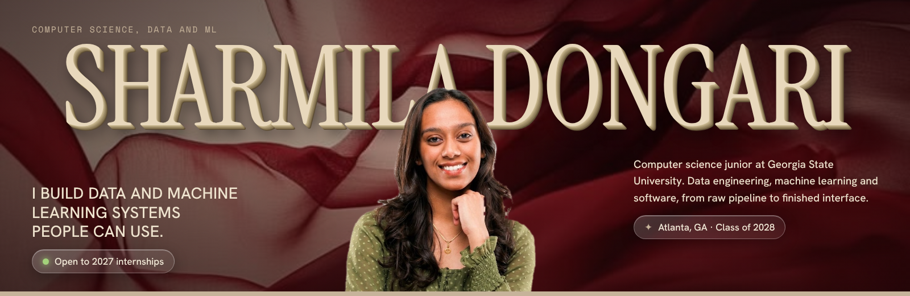
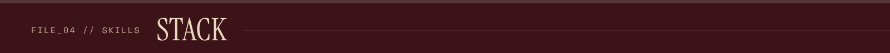
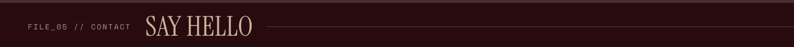

  

  <a href="https://sharmilad24.github.io"><b>Portfolio</b></a> &nbsp;·&nbsp;
  <a href="https://sharmilad24.github.io/Sharmila_Dongari_Resume.pdf"><b>Resume</b></a> &nbsp;·&nbsp;
  <a href="https://www.linkedin.com/in/sharmila-dongari-1017a42a8/"><b>LinkedIn</b></a> &nbsp;·&nbsp;
  <a href="mailto:sdongari24@gmail.com"><b>Email</b></a>

- **Data Analyst Intern, Weyerhaeuser** (summer 2026). dbt and Snowflake models feeding a 12 table Power BI semantic model.
- **Undergraduate Researcher, Assistive Navigation Lab, Georgia State.** A* path planning and obstacle avoidance for a real time assistive device for blind and low vision users.
- **Program Analyst, NASA L'SPACE Mission Concept Academy.** Risk, cost and schedule baselines for a 20 member mission concept team.

| Project | What it does | Stack |
| --- | --- | --- |
| [**MARTA Transit Reliability**](https://github.com/sharmilad24/marta-transit-reliability) | Collects live rail data every 2 minutes, forecasts delays within 78 seconds on average, and routes trips in a Streamlit app. [Live app](https://marta-trip-planner.streamlit.app/) | Python, SQL, scikit-learn, Streamlit, Power BI |
| [**Job Market Dashboard**](https://github.com/sharmilad24/Job-market-dashboard) | Pulls 300+ postings from the Adzuna API and predicts role seniority at 67.8 percent accuracy. [Live app](https://sharmila-job-market.streamlit.app) | Python, Pandas, scikit-learn, Streamlit, Plotly |
| [**Last Voyage**](https://github.com/sharmilad24/reddit-hackathon-project) | Daily escape game for Reddit with seeded, always winnable boards and a Redis leaderboard. | TypeScript, Devvit Web, Redis, Canvas |
| [**FaceVault**](https://github.com/sharmilad24/Facevault) | Face recognition from FaceNet embeddings, with a 2D map of the vector space. | Python, DeepFace, TensorFlow, Streamlit |

**Languages** &nbsp; Python, SQL, Java, JavaScript, TypeScript, R, C, HTML
**Machine learning** &nbsp; scikit-learn, PyTorch, TensorFlow
**Data and cloud** &nbsp; Snowflake, dbt, AWS, SQLite, Power BI, Plotly, Streamlit
**Spoken** &nbsp; English, Telugu, German

Looking for 2027 internships in software engineering, data and machine learning. The fastest way to reach me is [sdongari24@gmail.com](mailto:sdongari24@gmail.com).
